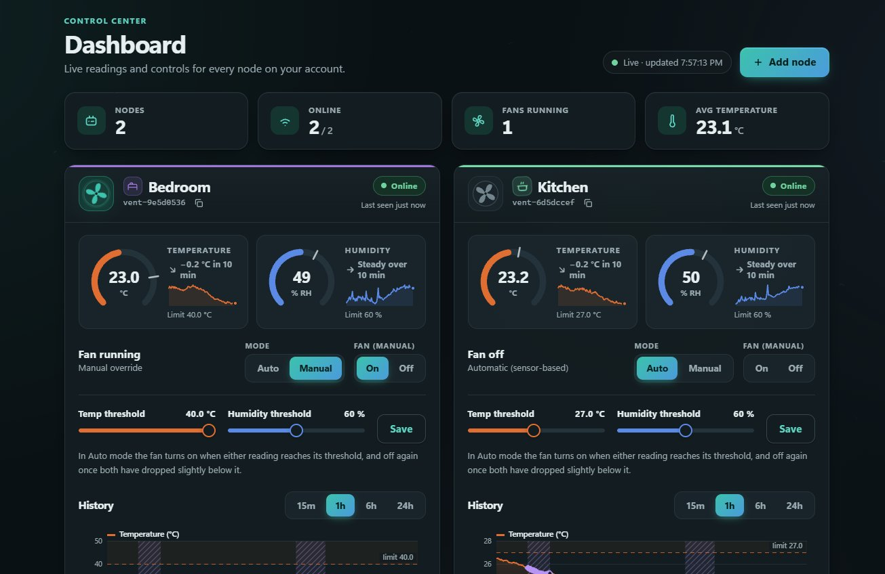
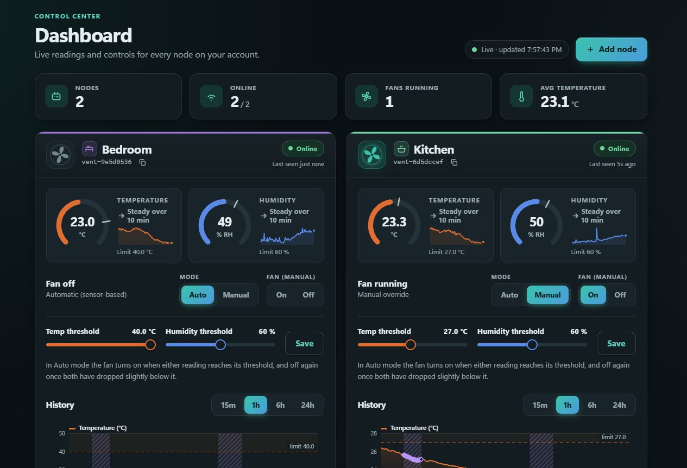
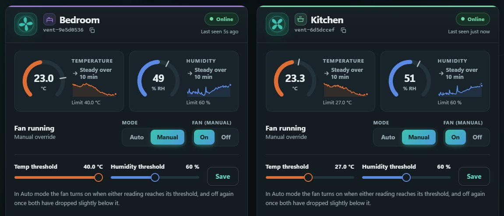
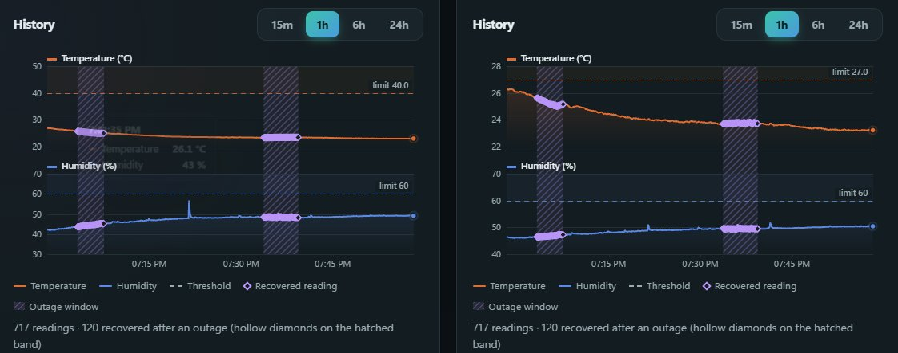
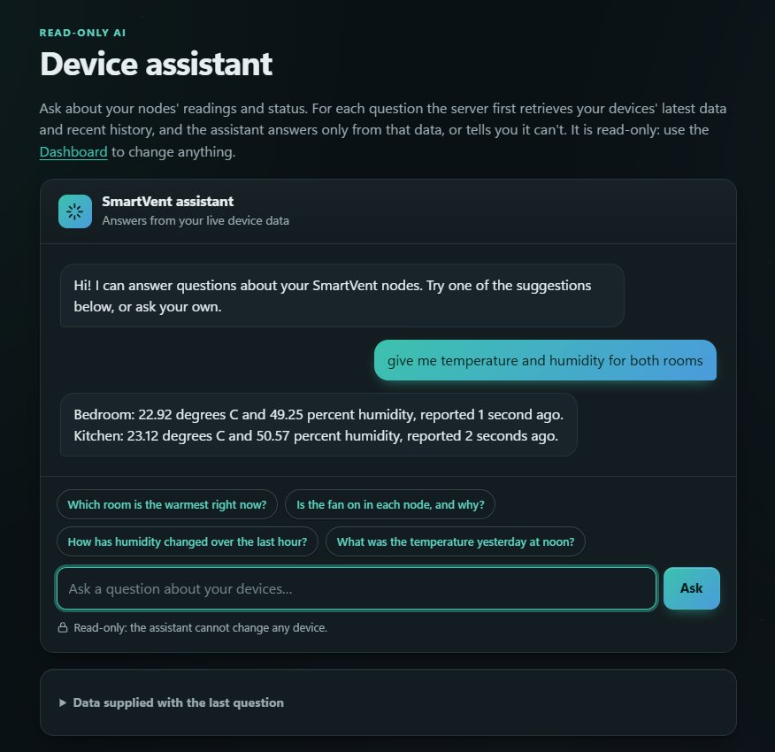
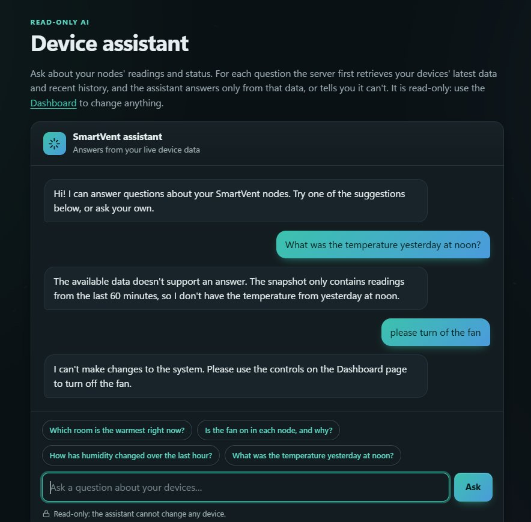
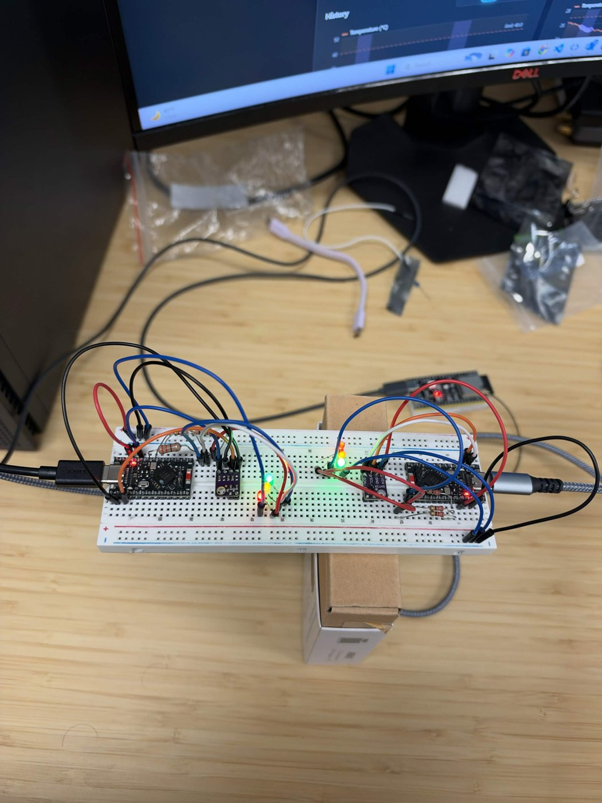
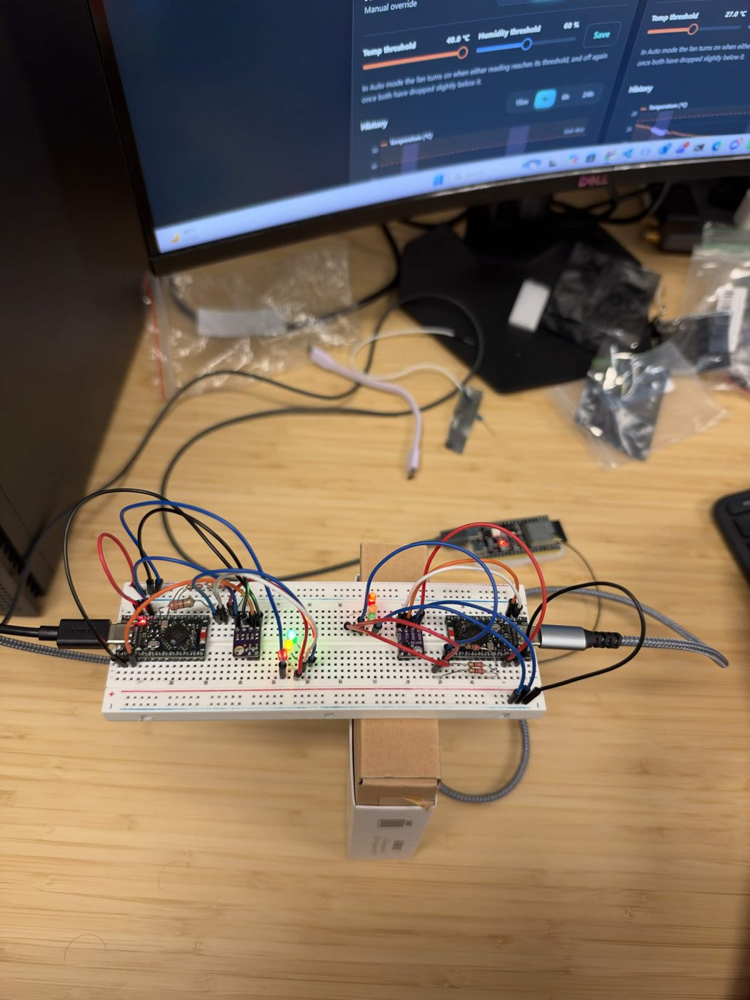

# SmartVent: project documentation and user manual

ECE 413/513 "Make It Smart", Fall 2026, University of Arizona.
Team: Parsa Mirfasihi, Afsah Khan and Sarower Afjal. Website: https://3-17-254-71.sslip.io. Source: https://github.com/parsamrf/smartvent

This document is the user manual and the project report. It covers the ECE 513 requirements (HTTPS and offline data recovery) and the AI Device Assistant extra credit.

## 1. Overview

SmartVent is a smart-ventilation system. Two sensor nodes (nRF52840, nice!nano boards) each measure **temperature and relative humidity** with a Sensirion SHT31. Each node runs its own **automatic control rule**: it turns its fan output on when either reading reaches a threshold and off again once both have dropped slightly below it. The nodes report over Bluetooth LE to an ESP32-S3 gateway, which relays to AWS IoT Core over MQTT with TLS. A web app shows live readings, lets a logged-in user switch each node between Auto and Manual, switch its fan on or off, and change its thresholds. The nodes are named **Bedroom** and **Kitchen** in the dashboard.

| | Sensors | Outputs | Automatic control |
|---|---|---|---|
| Each node | SHT31 (temperature, humidity) | Fan output (green LED stands in for the fan), manual-mode LED (yellow), BLE-link LED (red) | Fan ON when temperature >= 27 C or humidity >= 60 %, OFF when temperature < 26.5 C and humidity < 57 % (configurable per node) |

## 2. Project implementation

### 2.1 Sensor nodes and circuits
- **Board:** nice!nano (nRF52840) with the Adafruit UF2 bootloader. Firmware: Zephyr / nRF Connect SDK v3.4.1, target `promicro_nrf52840/nrf52840/uf2`.
- **Circuit:** SHT31 breakout on I2C0 at address 0x44. VIN to VCC (3.3 V), GND to GND, SDA to pin 006 (P0.06), SCL to pin 008 (P0.08), with the chip's internal pull-ups enabled. Three LEDs, each through a resistor to ground: green on 031 (fan), yellow on 029 (manual mode), red on 002 (gateway connected). The board's own LED also mirrors the fan.
- **Behaviour:** every 5 s the node reads the sensor, runs the control rule, drives the LEDs and sends a telemetry notification. A command received over BLE wakes the loop early, so the new state is reported within about a second. A failed sensor read is flagged invalid (the dashboard shows dashes). After six failed reads in a row the node reboots itself.
- **Identity:** each node derives a unique id `vent-xxxxxxxx` from its factory-programmed chip id. Ours are `vent-9e5d0536` (Bedroom) and `vent-6d5dccef` (Kitchen).

### 2.2 BLE communication
Each node is a BLE peripheral with one custom GATT service (128-bit UUID base `5f0a0000-7c3e-4b8a-9f4e-2d1c0b5a6e00`) and three characteristics:
- **Device ID** (read): the node's id string. The gateway reads it after connecting and uses it as the routing key.
- **Telemetry** (read and notify, 20 bytes): protocol version, mode, fan state, validity flags, temperature and humidity in hundredths, the node's thresholds, and a sequence number.
- **Command** (write, 8 bytes): an opcode (set auto, set manual, set fan, set thresholds) plus arguments.

### 2.3 ESP32-S3 gateway
The gateway (PlatformIO, Arduino, NimBLE-Arduino) is a BLE central that scans, connects to up to two nodes, subscribes to their telemetry and keeps one connection slot per node. It converts each telemetry packet to JSON and publishes it with MQTT over TLS (port 8883) to AWS IoT Core, authenticating with an X.509 device certificate. It reconnects to BLE, Wi-Fi and MQTT automatically with back-off. Time comes from NTP so each reading carries a real timestamp.

### 2.4 AWS services, APIs and authentication
- **AWS IoT Core** receives MQTT on `smartvent/<id>/telemetry|backfill|ack` and sends commands on `smartvent/<id>/cmd`. IoT rules write telemetry to the `Latest` and `History` DynamoDB tables, backfill to `History` only, and acknowledgements to `Commands`.
- **DynamoDB:** `Devices` (owner and name per node, owner index), `Latest` (current state), `History` (time series, expires after 30 days), `Commands` (command log, expires after 24 h).
- **API Gateway (HTTP API) and Lambda (Python 3.12):** endpoints to register and list devices, read history, send commands, change settings, check command status, and ask the assistant. Full request and response formats are in [API.md](API.md).
- **Authentication:** Amazon Cognito user pool. The website signs users in and sends the ID token to the API, whose JWT authorizer rejects requests without a valid token. Every Lambda also checks that the caller owns the device it touches.

### 2.5 Web application
Static HTML, CSS and JavaScript (no framework), served by nginx on an EC2 instance. Pages: home and team, register, login, dashboard, assistant and references. The dashboard polls the API and shows each node's gauges, trend lines, fan state, mode controls, threshold sliders and a history chart that marks recovered readings. A demo mode (`dashboard.html?demo`) runs the whole interface on simulated data without hardware.

### 2.6 How sensor data reaches the dashboard
1. The node reads its SHT31 and sends a 20-byte BLE notification.
2. The gateway decodes it and publishes JSON to `smartvent/<id>/telemetry`.
3. An IoT rule stores it in `Latest` (overwriting the current state) and `History`.
4. The dashboard calls `GET /devices` and shows it.

### 2.7 How a command reaches the correct node
1. The dashboard calls `POST /devices/{id}/commands`. API Gateway checks the login token.
2. The Lambda verifies the caller owns that device and that the command is valid, then publishes to the topic `smartvent/<id>/cmd` for that one node.
3. The gateway receives it, builds the 8-byte packet and writes it **only** to the BLE connection whose Device ID characteristic equals `<id>`. The other node never sees it.
4. The node applies the command and immediately reports its new state.
5. The dashboard shows **Sent, Delivered, Confirmed**. It only shows Confirmed when the node's next telemetry (a new sequence number) reports the requested state.

### 2.8 HTTPS (ECE 513)
The website is served by nginx with a Let's Encrypt certificate renewed by a systemd timer (current certificate expires 26 Jan 2027). Plain HTTP requests get a 301 redirect to HTTPS and the server sends an HSTS header. The API Gateway and Cognito endpoints are HTTPS only, and the gateway talks to AWS IoT using mutual TLS. Login credentials, device data and commands never travel over plain HTTP.

### 2.9 Offline data recovery (ECE 513)
While Wi-Fi or MQTT is down, the gateway keeps receiving readings from both nodes over BLE and stores each one, with its receive time and node id, in a 720-entry RAM ring buffer (about 30 minutes for two nodes). When the connection returns it uploads the buffer oldest first to `smartvent/<id>/backfill`, five messages per loop pass, while live reporting continues. A separate IoT rule stores backfill messages in `History` with `source: "backfill"`; they never overwrite `Latest`. The history chart marks them as purple diamonds.

### 2.10 AI Device Assistant (extra credit)
- **Model:** the open-source **Qwen 3.8 27B**, served through Groq's OpenAI-compatible chat API (free tier). The API key is stored in AWS SSM Parameter Store and is read only by the Lambda; it is never in the browser or the repository.
- **Data supply:** when the user asks a question, the Lambda first loads that user's devices, each node's latest reading and a summary of the last 60 minutes of history from DynamoDB. It sends this as JSON, with times given as "seconds ago", together with the question.
- **Behaviour:** the system prompt tells the model to answer only from that data, to refer to each device by name, and to say plainly when the data does not support an answer. It has no tools and cannot send commands, so it is read-only; control stays behind the authenticated command endpoints.

## 3. User manual
1. **Register or log in** at the website (the README lists a test account that already has data).
2. **Add a node** with the "Add node" button: enter its id (printed on its serial console, `vent-xxxxxxxx`) and a name.
3. **Watch it live.** Each card shows the current temperature and humidity, a 10-minute trend, the fan state and whether the node is online.
4. **Control it.** Choose Auto (the fan follows the sensors) or Manual (use On / Off). Move the threshold sliders and press Save to change the automatic limits.
5. **Read history** with the 15 min, 1 h, 6 h and 24 h buttons. Purple diamonds are readings recovered after a network outage.
6. **Ask the assistant** a question about your devices on the Assistant page.

## 4. File descriptions

| File | Purpose |
|---|---|
| `firmware/node/src/main.c` | Main loop: sample, control, drive LEDs, pack and send telemetry, reboot on repeated sensor failure |
| `firmware/node/src/sensors.c` | SHT31 reading over I2C (or simulated values) |
| `firmware/node/src/control.c` | Automatic rule with hysteresis, manual override, command decoding |
| `firmware/node/src/ble_service.c` | GATT service, advertising and reconnection |
| `firmware/node/src/protocol.h` | Packet layouts and UUIDs shared with the gateway |
| `firmware/node/src/dfu_reboot.c` | Reboots into the UF2 bootloader when a byte arrives on USB serial |
| `firmware/node/boards/promicro_nrf52840_nrf52840_uf2.overlay` | Pin wiring: I2C pins, SHT31 address, LEDs |
| `firmware/gateway/src/main.cpp` | Glue: telemetry routing, command translation and routing, backfill |
| `firmware/gateway/src/ble_central.cpp` | BLE central: scan, connect to two nodes, per-node slots, command writes |
| `firmware/gateway/src/cloud.cpp` | Wi-Fi, NTP and MQTT over TLS to AWS IoT with reconnect back-off |
| `firmware/gateway/src/offline_buffer.cpp` | Ring buffer for readings received while offline |
| `firmware/gateway/src/telemetry.h` | Binary packet to JSON conversion |
| `cloud/template.yaml` | AWS SAM template: Cognito, DynamoDB, IoT rules, HTTP API, Lambdas |
| `cloud/src/devices.py` | Register, list, rename and delete nodes |
| `cloud/src/history.py` | History queries |
| `cloud/src/commands.py` | Commands, settings and command status; publishes to IoT Core |
| `cloud/src/assistant.py` | Read-only assistant: loads device data, calls the LLM |
| `cloud/src/presignup.py` | Cognito trigger that auto-confirms sign-ups |
| `cloud/src/common.py` | Shared helpers: auth claims, ownership check, responses |
| `cloud/deploy.ps1`, `cloud/setup-iot.ps1` | Deploy the stack; create the gateway's IoT certificate |
| `server/setup-ec2.sh`, `server/smartvent.conf`, `server/deploy-web.ps1` | nginx and HTTPS setup; upload the website |
| `web/*.html`, `web/css/style.css` | Pages and styling |
| `web/js/auth.js`, `api.js` | Cognito login and authenticated API client |
| `web/js/dashboard.js`, `chart.js` | Dashboard logic and the history chart |
| `web/js/assistant.js` | Assistant chat page |
| `web/js/bg.js`, `fx.js`, `home.js`, `layout.js`, `ui.js` | Background animation, interaction effects, home page, shared layout and helpers |
| `web/js/demo-api.js` | Simulated backend for demo mode |

## 5. Results
Both nodes were verified end to end. The full demo is recorded in two videos, listed in the [README](../README.md): part 1 (12:01) shows the website and the user experience, part 2 (7:38) walks through the implementation. Evidence recorded during testing:

- **Both nodes reporting:** the gateway log shows `nodes=2`, and the dashboard shows Bedroom and Kitchen live. Example live readings: Bedroom 23.4 C / 48.5 %, Kitchen 23.8 C / 49.4 %.
- **Automatic control:** warming the Kitchen sensor above 27 C (peak about 33 C) turned its fan on automatically, and the dashboard showed "Over limit" with "Fans running: 1".
- **Manual control:** Manual then On on Bedroom lit its manual (yellow) and fan (green) LEDs together with the always-on link (red) LED, and the dashboard completed Sent, Delivered, Confirmed. Switching back to Auto and raising the limit turned the fan LED off.
- **Device-specific commands:** in the routing test, Bedroom was set to Manual with the fan on while Kitchen stayed in Auto with the fan off, and then the reverse. Each card kept its own state, so a command reaches only the node it was sent to.
- **Offline recovery:** the hotspot was turned off from 19:33:44 to 19:39:19 (about 5 min 35 s). The gateway kept both nodes connected over BLE and buffered 136 readings. After reconnecting it logged `Backfill complete`, and DynamoDB held 68 backfill records per node at 5-second spacing with no duplicates. `Latest` stayed live. The gateway's log is saved in [evidence/offline-recovery-gateway.log](evidence/offline-recovery-gateway.log).
- **HTTPS:** HTTP returns a 301 redirect to HTTPS, HSTS is present, and the certificate verifies.
- **Assistant:** it answered "which room is warmest", "is the fan on in each room and why" and "how has humidity changed in the last hour" from live data, said the data did not support an answer for "CO2 level" and "temperature yesterday at noon", and declined to switch a fan on.

### Recorded readings
Latest stored reading of each node, read from the `Latest` table through `GET /devices` (time shown in UTC):

| Node | Device id | Temperature | Humidity | Mode | Fan | Last update |
|---|---|---|---|---|---|---|
| Bedroom | `vent-9e5d0536` | 23.21 C | 46.19 % | Auto | Off | 2026-11-03 19:25:29 |
| Kitchen | `vent-6d5dccef` | 23.39 C | 48.17 % | Auto | On | 2026-11-03 19:25:28 |

The Kitchen fan is on at 23.39 C because that node's humidity limit was lowered to 45 % for the demo, and its humidity (48.17 %) was above it. Each node applies its own thresholds.

### Screenshots and photos
Device-specific commands. Bedroom in Manual with the fan on, Kitchen still in Auto with the fan off:

The reverse: Kitchen in Manual with the fan on, Bedroom in Auto with the fan off:

Both nodes in Manual with the fan on:

History of both nodes. The hatched bands are network outages; the hollow purple diamonds are readings the gateway buffered and uploaded after reconnecting (120 recovered readings per node over the two outage windows in this hour):

The Device Assistant answering about both rooms from live readings:

A question the data cannot answer (the assistant only has the last 60 minutes, so it says so), and a request to change a device, which it refuses because it is read-only:

The hardware: two nodes (nice!nano with SHT31 and three LEDs each) on one breadboard, and the ESP32-S3 gateway behind them:

## 6. Lessons learned
- We learned that a gateway can only be trusted for recovery if it stores each reading's original timestamp, because replayed data would otherwise look like new data.
- We learned to confirm a command only when the node's next telemetry reports the requested state, because a successful BLE write does not prove the node applied it.
- We learned that reporting a failed sensor read as invalid is safer than repeating the last good value, which hid a real fault from us during testing.
- We learned that routing commands by a device id read from the node itself, rather than by connection order, keeps a command for one node from ever reaching the other.
- We learned that keeping API keys and device certificates out of the repository and the browser, in SSM Parameter Store and a git-ignored file, is simple to do early and painful to retrofit.
- We learned to build a small diagnostic tool, a bit-banged I2C pin scanner, when the hardware was misbehaving instead of guessing from photos.

## 7. Challenges
- **The ESP32-S3 would not join the Wi-Fi hotspot.** The hotspot was on 5 GHz, which the chip does not support; we turned on "Maximize Compatibility" to force 2.4 GHz.
- **The nRF Connect SDK download failed twice on a checksum.** We deleted the corrupted bundle and downloaded it again.
- **The SDK build failed because our project folder name contains a space.** We build from a copy in a path without spaces.
- **The SHT31 stopped answering and later returned all zeros.** A loose power jumper made both I2C lines read low. We found the pins with the scanner, enabled internal pull-ups, and added a self-reboot after repeated failures.
- **The nice!nano has no reset button, so reflashing needed shorting RST to GND twice.** We added firmware that reboots into the UF2 bootloader when a byte arrives on USB serial.
- **The free tier of the language-model API rejected rapid requests and the first answers contained raw timestamps and markdown.** We shrank the data sent, retry once when rate-limited, send times as "seconds ago" and strip markdown from the reply.

## 8. Team contributions

| Component | Parsa Mirfasihi | Afsah Khan | Sarower Afjal | Total |
|---|---|---|---|---|
| Hardware | 35 % | 35 % | 30 % | 100 % |
| Firmware (nodes and gateway) | 35 % | 35 % | 30 % | 100 % |
| Cloud backend | 35 % | 35 % | 30 % | 100 % |
| Web application | 35 % | 35 % | 30 % | 100 % |
| Documentation | 35 % | 35 % | 30 % | 100 % |
| Demonstrations | 35 % | 35 % | 30 % | 100 % |

All three members worked on every part of the system, so each component has the same split. Links: [Parsa Mirfasihi](https://www.linkedin.com/in/parsa-mirfasihi/), [Afsah Khan](https://www.linkedin.com/in/afsah-sharaf-khan-029384311/), [Sarower Afjal](https://www.linkedin.com/in/sarower/).

## 9. References
- **Platforms and SDKs:** [nRF Connect SDK and Zephyr](https://docs.nordicsemi.com/bundle/ncs-latest/page/nrf/index.html), [PlatformIO](https://platformio.org/), [Arduino-ESP32](https://github.com/espressif/arduino-esp32).
- **Libraries:** [NimBLE-Arduino](https://github.com/h2zero/NimBLE-Arduino), [PubSubClient](https://github.com/knolleary/pubsubclient), [ArduinoJson](https://arduinojson.org/), Zephyr's SHT3xD sensor driver.
- **Hardware:** [Sensirion SHT3x datasheet](https://sensirion.com/products/catalog/SHT31-DIS-B), [nice!nano](https://nicekeyboards.com/nice-nano/), [Adafruit nRF52 bootloader](https://github.com/adafruit/Adafruit_nRF52_Bootloader).
- **AWS:** [AWS IoT Core](https://docs.aws.amazon.com/iot/), [DynamoDB](https://docs.aws.amazon.com/dynamodb/), [API Gateway HTTP API](https://docs.aws.amazon.com/apigateway/latest/developerguide/http-api.html), [Lambda](https://docs.aws.amazon.com/lambda/), [Cognito](https://docs.aws.amazon.com/cognito/), [AWS SAM](https://docs.aws.amazon.com/serverless-application-model/).
- **Web hosting and HTTPS:** [nginx](https://nginx.org/en/docs/), [Let's Encrypt and Certbot](https://certbot.eff.org/).
- **Assistant model:** [Qwen](https://github.com/QwenLM/Qwen3) served through [Groq's API](https://console.groq.com/docs).
- **AI development tools:** Claude Code (Anthropic) was used as a development assistant to help write, refactor and debug code and documentation. The team wired and tested the hardware, ran the system and reviewed all submitted code. See "AI tool usage" in the [README](../README.md).
- **Course material:** the [ECE 413/513 project template](https://github.com/prismlabarizona/ECE_415-513_Project_Template) and the Nordic [Bluetooth LE Fundamentals](https://academy.nordicsemi.com/courses/bluetooth-low-energy-fundamentals/) course.
